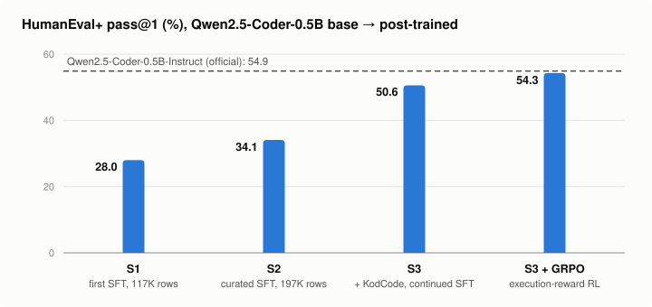
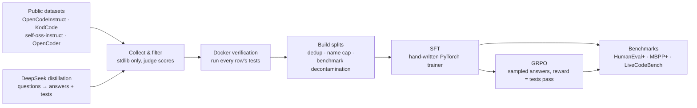

# PyDrithGPT

**Post-training a 0.5B-parameter language model to write correct Python, from the base checkpoint up.**

I took [Qwen2.5-Coder-0.5B](https://huggingface.co/Qwen/Qwen2.5-Coder-0.5B) (the *base* model, not the instruct one) and built the whole post-training stack around it myself: data collection and execution-based filtering, a hand-written PyTorch SFT trainer, a GRPO reinforcement-learning loop with sandboxed test rewards, and a reproducible benchmark harness. Training ran on rented H100s for a few dollars per run.

<p align="center">
  
</p>

## Results

All numbers are greedy pass@1 from my own harness: same chat prompt, 512 new tokens, graded with [EvalPlus](https://github.com/evalplus/evalplus) in Docker. The official Qwen instruct model was run through the identical pipeline as a reference.

| Model | HumanEval | HumanEval+ | MBPP | MBPP+ |
|---|---:|---:|---:|---:|
| Qwen2.5-Coder-0.5B base, chat prompt¹ | 11.6 | 9.1 | n/a | n/a |
| **S1**: first SFT, 117K educational examples | 30.5 | 28.0 | n/a | n/a |
| **S2**: curated SFT, 197K verified examples | 36.6 | 34.1 | 55.3 | 48.7 |
| **S3**: + KodCode, continued SFT, 265K examples | 53.7 | 50.6 | 60.3 | 51.1 |
| **S3 + GRPO** (best model) | **56.1** | **54.3** | 60.3 | **53.4** |
| *Reference: official Qwen2.5-Coder-0.5B-Instruct* | *59.8* | *54.9* | *52.9* | *43.9* |

¹ The base model has no chat training, so it often runs past the token limit under a chat prompt; this row is a floor rather than a fair comparison.

**In short:** starting from the base model, the final checkpoint scores within 0.6 points of Qwen's own instruct model on HumanEval+ and about 9.5 points above it on MBPP+. That instruct model was trained with far larger internal data and staged SFT plus DPO.

## Pipeline



### 1. Data: verified by execution, not by trust

- **Sources:** [OpenCodeInstruct](https://huggingface.co/datasets/nvidia/OpenCodeInstruct) (5M rows read in full), [KodCode](https://huggingface.co/datasets/KodCode/KodCode-V1), [self-oss-instruct-sc2](https://huggingface.co/datasets/bigcode/self-oss-instruct-sc2-exec-filter-50k), [OpenCoder educational_instruct](https://huggingface.co/datasets/OpenCoder-LLM/opc-sft-stage2), plus about 3,000 rows I generated myself.
- **Own distillation pipeline** ([`distill_*.py`](DISTILL_STAGES.md)): the program assigns each question a skill, a form (describe, complete-from-docstring, fix-a-bug) and a difficulty; DeepSeek writes the questions, then a solution with assert tests; each solution runs in a locked-down Docker container. Structural checks reject tests that never call the function, changed signatures and leaked solutions. Result: 3,071 accepted rows for **USD 19**.
- **Every row's tests are re-run in Docker** ([`curate_verify.py`](curate_verify.py)): network off, memory, process and time limits, batch execution with a single-row fallback, resumable.
- **Deduplication and decontamination** ([`curate_build.py`](curate_build.py)): exact and near-duplicate removal, a cap on rows per function name (OpenCodeInstruct alone has 6,204 `is_prime` variants), and removal of anything matching HumanEval+/MBPP+ by function name or wording (about 3,000 rows).

### 2. Supervised fine-tuning: a trainer written from scratch

[`train_torch.py`](train_torch.py) is a single-file PyTorch training loop (about 300 lines) that replaced Hugging Face's `SFTTrainer` after the first run:

- completion-only loss, with the loss of a 64-row update normalised per graded token however the rows are split into chunks;
- length-sorted chunking under a padded-token budget (16K positions) instead of a fixed batch size;
- bf16 autocast, warmup plus cosine schedule, gradient clipping, NaN-gradient update skipping;
- periodic validation, checkpointing and exact resume (verified to reproduce the loss to four decimals).

S3 trained 8,296 updates over 236M tokens in **102 minutes on one H100 NVL**.

### 3. Reinforcement learning: GRPO with sandboxed rewards

[`train_grpo.py`](train_grpo.py) implements Group Relative Policy Optimization directly in PyTorch:

- 16 tasks × 8 sampled answers per step; reward 1 if every test passes;
- group-normalised advantages, with all-pass and all-fail groups dropped as they carry no signal;
- answers executed in parallel in Docker (on the Mac) or a resource-limited subprocess (on rented GPUs);
- task pool ([`grpo_pool.py`](grpo_pool.py)) drawn from verified rows never used in SFT, with benchmark look-alikes removed.

Before writing it I measured whether RL had anything to work with: S3's HumanEval+ pass@10 was 72.0 against 50.6 greedy, and 39% of held-out training-style tasks gave mixed pass/fail across 8 samples.

### 4. Evaluation

- [`benchmark_humaneval.py`](benchmark_humaneval.py) generates HumanEval+/MBPP+ answers and records the model, prompt, decoding settings and dataset hash; [`grade_humaneval.py`](grade_humaneval.py) refuses to grade if the dataset hash differs.
- [`benchmark_validation.py`](benchmark_validation.py) measures pass rate on 1,000 held-out tested training-style tasks.
- [`benchmark_lcb.py`](benchmark_lcb.py) runs LiveCodeBench v6 (Jan–Apr 2025), with problems published after the base model was released.

## What I learned (and what didn't work)

- **Validation loss picks the wrong checkpoint.** S3's lowest-loss checkpoint (end of epoch 1) scored 5 points lower on HumanEval+ than the final one. I now choose checkpoints by executed tests only.
- **A data bug that metrics didn't show.** Reading S3's failures turned up 20% of KodCode prompts (16,717 rows) with the pytest tests pasted into the question. I fixed the extractor and added a regression test.
- **Debugging NaN gradients on H100.** A run skipped 5 of its first 324 updates on non-finite gradients. I bisected attention backends and isolated it to PyTorch's cuDNN SDPA kernel with padded bf16 chunks (math, efficient, eager and float32 were all clean), then disabled that one kernel.
- **The third epoch memorises.** S2's validation loss jumped at the start of epoch 3 while training loss kept falling, so later runs use two epochs and more distinct data.
- **RL gains are small at this scale and hard to rank.** GRPO's held-out pass rate preferred the LR 1e-6 run, while the benchmarks preferred 3e-6. Every GRPO model gained 1–3 points on MBPP+, but only one moved HumanEval+, and most differences are near noise.
- **Distillation from a 7B teacher failed.** On-policy reverse-KL distillation from Qwen2.5-Coder-7B-Instruct drifted, in four configurations, into answers that never stopped (trailing tests, prose or repeated imports). The teacher also solved no more of the task pool than S3 did, so there was little to distil.
- **The ceiling is reasoning, not formatting.** The HumanEval+ tasks Qwen solves and S3 misses are mostly logic errors that contradict the prompt's own examples; restoring the original docstring did not help. LiveCodeBench is at the floor for every 0.5B model I tested (S3 3/175, Qwen Instruct 1/175).

## Repository layout

| Path | Purpose |
|---|---|
| [`curate_collect.py`](curate_collect.py), [`curate_verify.py`](curate_verify.py), [`curate_build.py`](curate_build.py) | Collect, Docker-verify and build SFT datasets ([guide](CURATE.md)) |
| [`distill_questions.py`](distill_questions.py), [`distill_answers.py`](distill_answers.py), [`distill_verify.py`](distill_verify.py) | Three-stage DeepSeek distillation ([guide](DISTILL_STAGES.md)) |
| [`train_torch.py`](train_torch.py) | Hand-written SFT trainer |
| [`grpo_pool.py`](grpo_pool.py), [`grpo_filter.py`](grpo_filter.py), [`train_grpo.py`](train_grpo.py) | GRPO task pools and RL trainer |
| [`distill_pool.py`](distill_pool.py), [`distill_filter.py`](distill_filter.py), [`train_distill.py`](train_distill.py) | On-policy distillation experiment from a 7B teacher (negative result) |
| [`infer.py`](infer.py) | Interactive generation from any checkpoint |
| `benchmark_*.py`, `grade_*.py` | HumanEval+, MBPP+, validation and LiveCodeBench harness ([guide](INFERENCE.md)) |
| [`tests/`](tests/) | 37 offline tests for the data pipeline and distillation checks |
| [`initial/`](initial/) | First-run code (S1 with TRL's `SFTTrainer`) and earlier collectors |
| [`TRAINING_LOG.md`](TRAINING_LOG.md) | Dated record of every run, measurement and decision |

## Running it

```bash
python -m venv .venv && source .venv/bin/activate
pip install torch          # pick the build for your hardware
pip install -r requirements.txt -r requirements-eval.txt
```

Talk to a checkpoint:

```bash
python infer.py --model runs/grpo-lr3e-6/final
```

Generate HumanEval+ answers, then grade them in Docker as described in [INFERENCE.md](INFERENCE.md):

```bash
python benchmark_humaneval.py --dataset humaneval --model runs/grpo-lr3e-6/final --out runs/benchmarks/my-run
```

Run the tests:

```bash
python -m unittest discover -s tests
```

Data, model weights and run outputs are not in Git. The pipeline rebuilds the datasets from pinned dataset revisions, and [CLOUD.md](CLOUD.md) covers training on a rented GPU.

## Hardware and cost

| Stage | Hardware | Notes |
|---|---|---|
| S1 | AMD RX 9070 XT (16 GB), ROCm under WSL2 | about 11 hours |
| S2, S3, GRPO | 1× H100 rented on Vast.ai | S2 run about USD 10, S3 102 min |
| Data, grading, development | M5 MacBook Air (16 GB) | Docker sandboxes, MPS for small checks |

## Limitations

- One benchmark run per model with greedy decoding; differences of 1–2 points are within noise (HumanEval+ has 164 tasks).
- Answers are code-only by design, so the model does not explain itself or chat the way an instruct model does.
- KodCode is licensed CC BY-NC 4.0, so models trained on S3 data are for non-commercial use.
- Weights are not published yet.

## Next steps

- Mix explanation-plus-code answers and some general chat into SFT for instruction following.
- Sequence-level distillation on teacher-verified answers, as a cheaper alternative to the failed on-policy setup.
- Harder RL task pools aimed at the reasoning failures, and multiple seeds so small gains can be told apart from noise.

## Acknowledgements

Built on [Qwen2.5-Coder](https://github.com/QwenLM/Qwen2.5-Coder), [EvalPlus](https://github.com/evalplus/evalplus), [LiveCodeBench](https://livecodebench.github.io/), and the datasets linked above. Training recipes were informed by the [OpenCoder](https://arxiv.org/abs/2411.04905) and [OpenCodeInstruct](https://arxiv.org/abs/2504.04030) papers.
